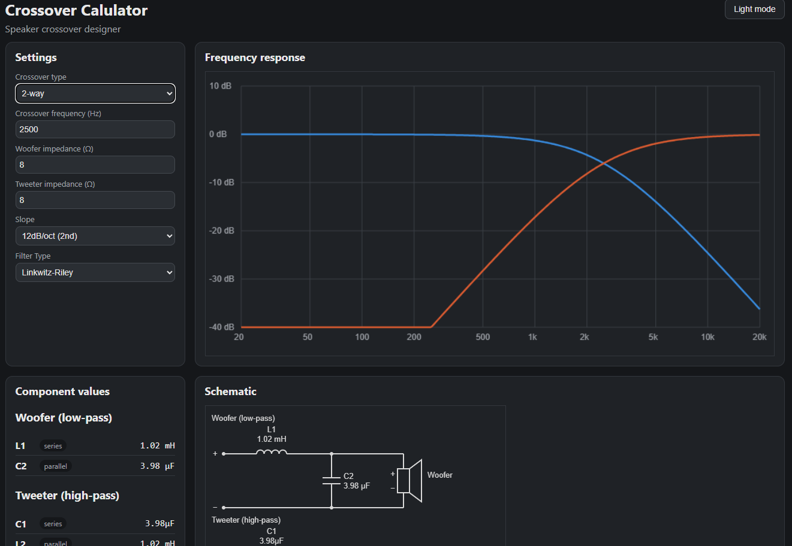
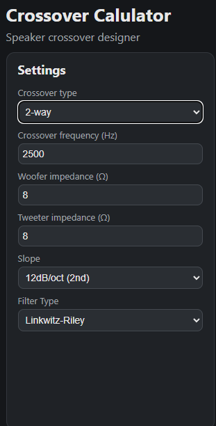
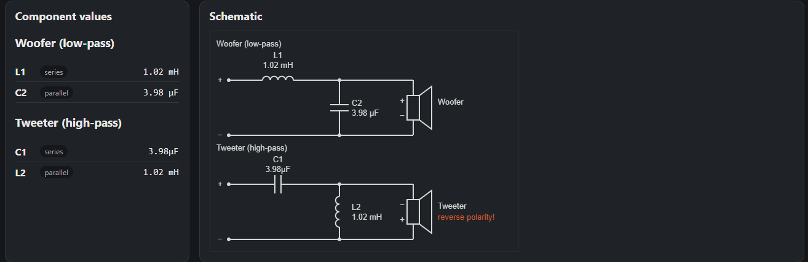
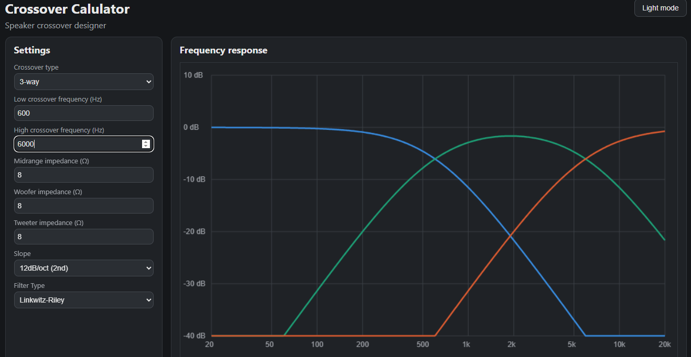
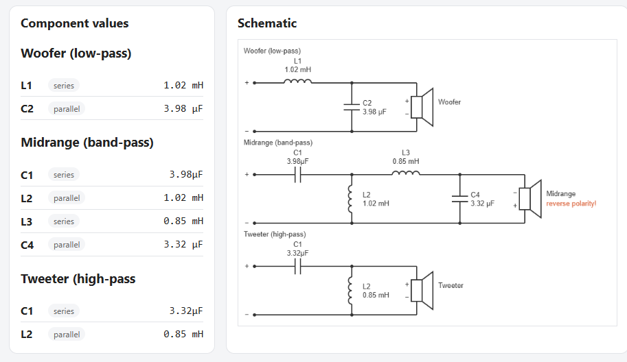

# CrossCalc

Speaker crossover designer - a web tool for designing passive speaker crossovers.

## Usage

Here you enter the parameters, like the cutoff frequency at which the crossover will operate, and parameters such as how much attenuation you want. For those who don't know, attenuation is in dB per octave, and an octave is half or double the cutoff frequency.

After entering the parameters, the attenuation curve in dB is displayed live, as shown in the image above. And based on the entered parameters, a schematic diagram is also created with calculated values for the capacitors and coils.

It's also possible to desing a crossover for 3 bands like bass, mids, and treble speakers.
So i wish you good luck with building the speaker crossover.

## How to run 

### Hosted instance 
- [Link!](https://kylda-007.github.io/CrossCalc)

### Local hosting
Clone the repository. Open `index.html` in your browser or set up a static web server.